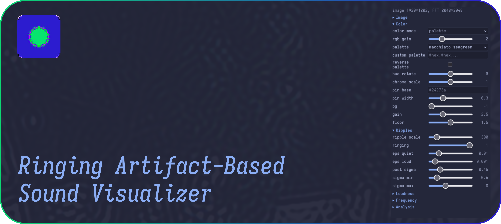

# Ringing Artifact-Based Sound Visualizer

A sound visualizer that uses Wiener deconvolution. Accessible at https://ringing-sound-visualization.vercel.app/.

This is an experiment I played around with an implemented over a weekend.
